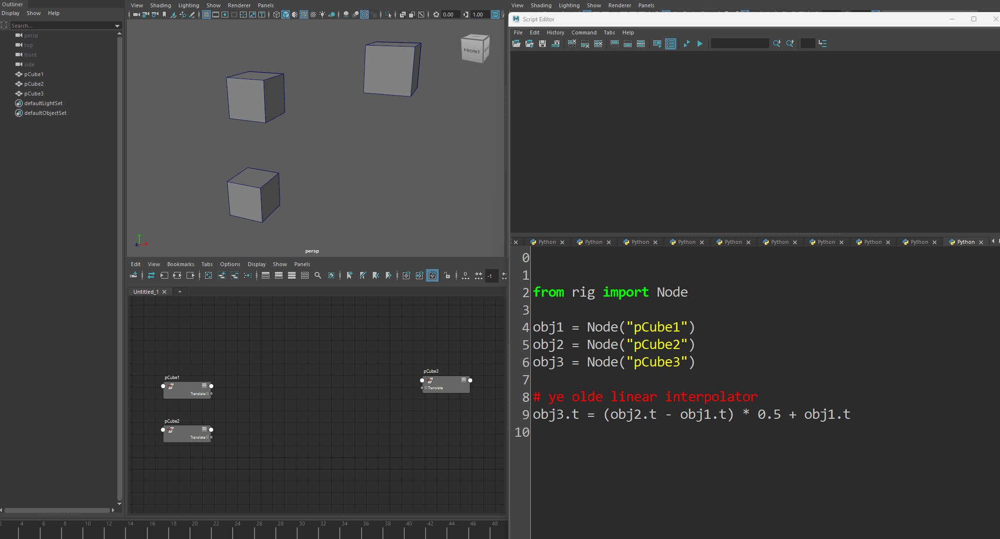
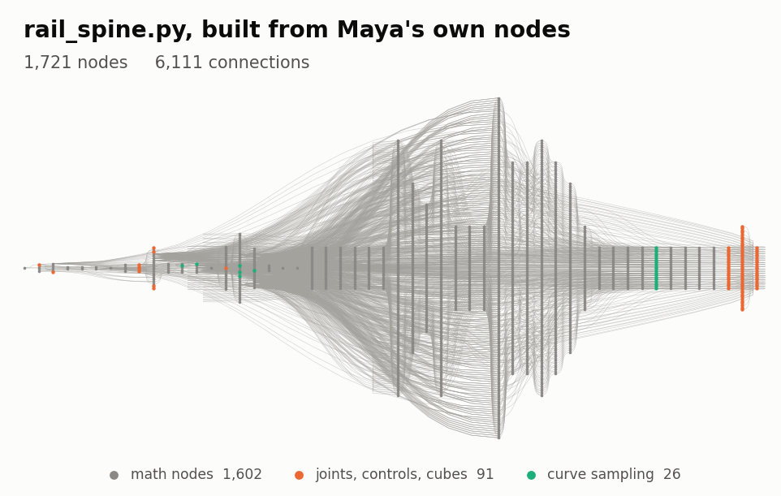
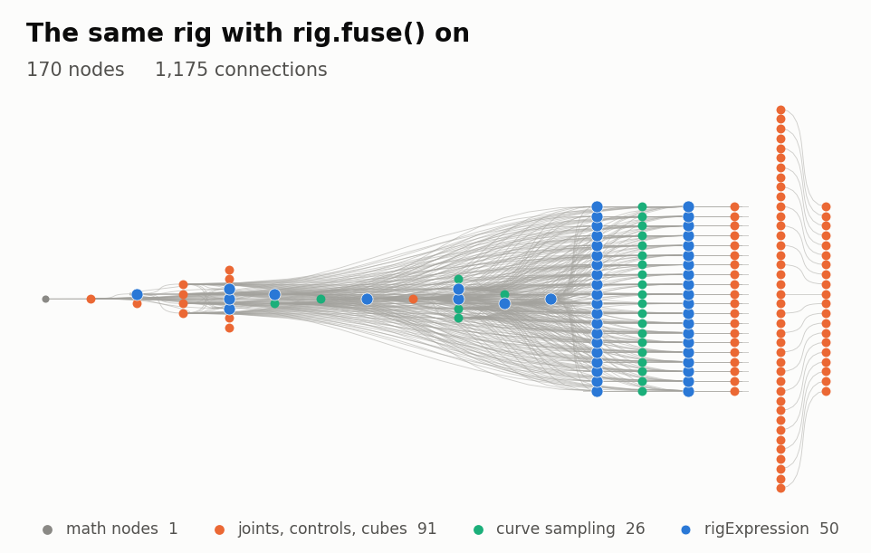

# rig

Rigging in Maya is three moves: make nodes, set attributes, connect them.
`rig` turns those moves into Python operators, so a build script reads like
the rig it describes.



## A taste

The script in the GIF, with the cubes made first so it runs in an empty scene:

```python
from maya import cmds
from rig import Node

for _ in range(3):
    cmds.polyCube()                                # pCube1, pCube2, pCube3
obj1, obj2, obj3 = Node("pCube1"), Node("pCube2"), Node("pCube3")

obj2.t << [10, 0, 0]                               # << sets a value

# ye olde linear interpolator
obj3.t << (obj2.t - obj1.t) * 0.5 + obj1.t         # math on plugs builds the nodes and wires them

print(obj3.t >> None)                              # >> reads: [5. 0. 0.]
```

That last assignment made three math nodes and connected them. Move either
cube and the third one stays halfway between.

## What you get

- **Operators for the everyday moves.** `<<` sets a value or makes a
  connection, `>>` reads. Arithmetic, comparisons and the math functions
  build the nodes behind them.
- **Lists that behave like one node.** `joints.rx << 45` sets every joint.
  `targets.t << sources.t * 2` builds one small network per pair.
- **Nothing built twice.** The same expression gives back the same nodes,
  and `Joint.define("spine_01")` makes the joint on the first run and finds
  it on the next, so a build script can be run again.
- **Nodes that know what they are.** A cube is a `Transform` with a `Mesh`
  under it, each with its own methods: components, tags, materials, skin
  weights, saving and loading.
- **Scenes that stay plain Maya.** rig builds Maya's own nodes, so a scene
  opens anywhere, with or without rig. The one exception is opt-in:
  `rig.fuse()`, next.

## rig.fuse(): fusing many nodes into a few

Complex, elegant rigs can lead to large node networks. The provided
[rail_spine.py](examples/rail_spine.py) example builds 1,721 nodes and
6,111 connections for a 20-joint spine. This is what the node graph looks
like for a single rider:



Turn on one option and rig compiles the math into `rigExpression` nodes
instead: the same rig and the same motion in 170 nodes and 1,175
connections, in a scene file half the size.



*Both pictures show Maya's Node Editor for the same spine built with a
single joint.*

```python
import rig

rig.set_options(fuse=True)   # everything built from here on

with rig.fuse():             # or only what this block builds
    build_spine()
```

Fusing is off by default. A fused scene needs rig's plug-in (`rig.mll`,
built from `plugins/`) wherever it is opened, and `rig.unfuse()` turns it
back into plain Maya nodes. More in the
[Cheatsheet](CHEATSHEET.md#43-rigfuse-math-in-one-node).

## Install

rig is a plain Python package. There is nothing to compile unless you want
`rig.fuse()`.

1. Clone it: `git clone https://github.com/Eric-Vignola/rig.git`
2. Put the folder that contains `rig/` on Maya's Python path. Not `rig/`
   itself: its `random.py` would hide Python's.
3. In Maya: `import rig`

It is tested on Maya 2025 and 2027, and needs numpy and scipy in Maya's
Python. Saving and loading geometry also needs cgmath (4.0.0rc1 or later).
`rig.fuse()` needs rig's plug-in, built once with `plugins/build.bat`
(`build.sh` on macOS): see [plugins](plugins/README.md). The fine print is
in the [Guide](GUIDE.md#requirements).

## Documentation

| | |
|---|---|
| [Guide](GUIDE.md) | How the language works: the operators, refer / define / create, the conventions, and what tends to surprise people in the first hour |
| [Cheatsheet](CHEATSHEET.md) | Every operator and top-level name, each with an example you can run |
| [rig.spec](spec/README.md) | Attributes: `Float`, `Vector`, `Enum` ... and `lock`, `hide` |
| [rig.bridges](bridges/README.md) | `maya.cmds` that hand back nodes, and a factory for every node type |
| [rig.nodetypes](nodetypes/README.md) | The node classes: `Transform`, `Mesh`, `Joint`, `SkinCluster` ... |
| [Examples](examples/README.md) | Complete builds: a rail spine, a limb twist, an image loop |

## License

BSD 3-Clause, see [LICENSE](LICENSE). Written by Eric Vignola (eric.vignola@gmail.com).
